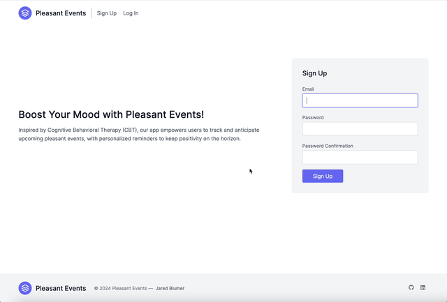

# Happeni

Inspired by Cognitive Behavioral Therapy (CBT), **Happeni** empowers users to create happiness by choosing and anticipating upcoming pleasant events. With personalized reminders, we help you stay focused on the positive moments that brighten your life.

> **Happeni is no longer hosted.** You can still run it locally by following the [instructions below](#running-locally). The screen recording below shows what the app looked like.



## Overview

Happeni is a Ruby on Rails web application that lets users log pleasant events they’re looking forward to and receive friendly reminders. The app is designed to help users maintain a positive outlook by focusing on enjoyable future activities, a technique often used in CBT to improve mental well-being.

## Features

- **Event Tracking** – Add and manage upcoming pleasant events with dates and details.
- **Reminders** – Personalized reminders to help you anticipate good things.
- **User-Friendly UI** – Clean, responsive interface styled with TailwindCSS.
- **Account Management** – Sign-up, login, email confirmation (Devise).
- **Spam Protection** – Google reCAPTCHA integration on sign-up forms.
- **Email Delivery** – Mailtrap integration for transactional emails.

## Tech Stack

- **Ruby on Rails 7.2**
- **PostgreSQL**
- **TailwindCSS**
- **Devise** – authentication with confirmation
- **Hotwire (Turbo + Stimulus)**
- **Mailtrap** – for email delivery
- **Google reCAPTCHA** – for spam prevention
- **RSpec** – test suite
- **FactoryBot & Faker** – test data generation
- **Shoulda Matchers** – model spec helpers

## Running Locally

The app is no longer hosted, but you can run your own copy locally.

### Prerequisites

- **Ruby 3.3.8** (see `.ruby-version` — a version manager like `rbenv`, `asdf`, or `rvm` is recommended)
- **PostgreSQL** installed and running locally
- **Bundler** (`gem install bundler`)

> No Node.js required — JavaScript is served via [importmap-rails](https://github.com/rails/importmap-rails), and Tailwind runs through the standalone `tailwindcss-rails` binary.

### 1. Clone and install dependencies

```bash
git clone https://github.com/jaredblumer/happeni.git
cd happeni
bundle install
```

### 2. Configure environment variables

In development, secrets are loaded from a `.env` file (via the `dotenv` gem). Create one in the project root:

```bash
# .env
RECAPTCHA_SITE_KEY=your_recaptcha_site_key
RECAPTCHA_SECRET_KEY=your_recaptcha_secret_key
```

Get keys from the [Google reCAPTCHA admin console](https://www.google.com/recaptcha/admin). For purely local testing, Google also publishes [test keys](https://developers.google.com/recaptcha/docs/faq#id-like-to-run-automated-tests-with-recaptcha.-what-should-i-do) that always pass validation.

> **Database:** `config/database.yml` expects a local PostgreSQL `postgres` role with password `password` on `localhost`. Either create that role or edit the `development`/`test` sections to match your setup.

### 3. Set up the database

```bash
bin/rails db:prepare
```

This creates and migrates the development database. (Alternatively, `bin/setup` installs gems and prepares the database in one step.)

### 4. Start the app

```bash
bin/dev
```

`bin/dev` boots both the Rails server and the Tailwind CSS watcher (see `Procfile.dev`). Visit **http://localhost:3000**.

### Email & account confirmation

Happeni uses Devise with email confirmation. Production delivered email via Mailtrap; locally, no email is sent unless you configure a mailer. To confirm a newly registered user without email, use the Rails console:

```bash
bin/rails console
```
```ruby
User.last.confirm
```

## Testing

Run the RSpec suite with:

```bash
bundle exec rspec
```
